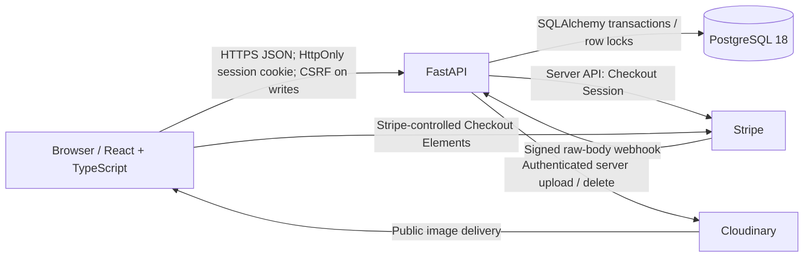

# PAWTEL architecture

PAWTEL is an Australian dog/cat boarding marketplace implemented as a modular
monolith: one React application, one FastAPI service, one PostgreSQL database.
External providers have explicit adapters; they are not separate PAWTEL services.



## Boundaries worth reviewing

- React Router separates public marketplace, private Owner account and Host
  workspace. TanStack Query owns server data; mutations invalidate collections and
  details. Logout clears private queries and transient Checkout state. There is no
  duplicated server-state Zustand store. Relative API paths support a single-origin
  deployment; Vite proxies locally.
- Session cookies hold high-entropy opaque credentials, HttpOnly and Secure in
  production. PostgreSQL stores only credential hashes; Argon2id hashes passwords.
  Exact Origin/custom-header/JSON checks and synchronizer CSRF protect writes.
  Active/verified-user dependencies and scoped queries enforce authority server-side.
- HostProfile is optional on the same User; one person can own Pets and host stays.
  Private Pet/Listing/Booking DTOs allowlist safe fields. Foreign and missing private
  resources share 404 semantics. The client cannot supply ownership or Booking price.
- Thin FastAPI routers call focused services, each with explicit transaction
  boundaries. SQLAlchemy models describe relational persistence; Pydantic schemas
  define separate input/output contracts. Alembic owns schema changes, never
  startup `create_all` or automatic migrations.
- Public discovery exposes only published Listings, safe Host summaries and ordered
  ready media. Availability is advisory. Price snapshots are integer AUD cents,
  with authoritative fee rounding performed once on the server.
- Stripe SDK calls and Cloudinary operations run outside long database locks.
  Persisted attempt/image states make uncertain external outcomes observable and
  recoverable. No raw card data touches PAWTEL: Stripe Elements owns those fields.
- Application JSON logs record safe events and route templates with request IDs;
  readiness checks PostgreSQL and exact schema revision, liveness only the process.
  [Operations](operations.md) documents ingress limits, configuration and deployment.

## One complete Booking journey

```mermaid
sequenceDiagram
    participant O as Owner / React
    participant A as FastAPI
    participant DB as PostgreSQL
    participant H as Host / React
    participant S as Stripe
    O->>A: Search published Listings / advisory availability
    A->>DB: Read Listing/species/reserved occupancy
    DB-->>O: Public DTO via API (no reservation)
    O->>A: POST Booking: listing_id, dates, pet_ids
    A->>DB: Transaction: verify scoped active Pets + species; quote; insert REQUESTED + Pets
    A-->>O: Server-owned price snapshot / REQUESTED
    H->>A: Explicit accept action
    A->>DB: Transaction: lock Listing, then Booking; recheck eligibility + overlapping capacity
    A->>DB: Set AWAITING_PAYMENT + deadline; commit reservation
    A-->>H: Payment required
    O->>A: Start authenticated/CSRF Checkout (Booking ID only)
    A->>DB: Transaction: durable PaymentAttempt/idempotency key; commit
    A->>S: Create/recover Checkout Session outside DB lock
    A->>DB: Second transaction: match/attach outcome or reconciliation state
    A-->>O: Transient client_secret for Checkout Elements
    O->>S: Stripe-controlled form / browser confirmation
    S->>A: Signed webhook with event ID
    A->>DB: Transaction: deduplicate receipt; Listing-first locks; validate amount/currency/attempt/state
    A->>DB: CONFIRMED if eligible; otherwise reconciliation; commit
    O->>A: Return/status: bounded refetch
    A-->>O: Actual persisted Booking state
```

Owner cancellation, acceptance, payment/expiry changes follow the established
Listing-first lock order. At READ COMMITTED the final capacity check happens under
the shared Listing lock; concurrent acceptors cannot both reserve the last space.
A request and a prior public availability response do not reserve capacity.
AWAITING_PAYMENT and CONFIRMED occupy capacity under the existing rules; expired
holds require explicit expiry transitions. Webhook success, not a redirect/query
string or browser callback, is payment confirmation authority.

## Failure modes and evidence

| Failure | Implemented response / test boundary |
| --- | --- |
| Duplicate Stripe event | Durable unique webhook receipt, repeated delivery idempotent; backend signed-event tests |
| Concurrent acceptance | Real separate PostgreSQL connections observe lock serialization, one winner for final space |
| Checkout timeout/unknown creation result | Persisted attempt and deterministic provider idempotency key; retry/reconciliation tests with fake gateway |
| Cancellation then late payment | State protection prevents unreserved confirmation; payment flagged for reconciliation, not automatic refund |
| Cloudinary succeeds but DB association fails | Persisted PENDING/cleanup state plus compensating delete/retry; fake adapter and DB-failure tests |
| Provider deletion fails | Local image hidden, cleanup remains visible to maintenance; no false distributed transaction guarantee |
| Missing/foreign private resource | Owner-scoped lookup with indistinguishable safe 404; ownership regression tests |
| Expired/revoked session | Hashed credential lookup rejects; UI clears private queries on logout/auth failure |
| Database down/schema mismatch | Minimal readiness 503; production startup refusal; safe correlated exception event |
| Oversized/chunked request | Actual-byte ASGI cap before downstream parsing; ingress bounds slow clients/concurrency |

The failure paths are not a promise that every production failure is solved.
Reconciliation and media cleanup need an operator/scheduler; monitoring, restore
exercises and real email delivery remain launch gaps. E2E deliberately stops at
AWAITING_PAYMENT; Stripe/media correctness stays in deterministic provider tests,
with sandbox/manual verification separately documented.

## Code navigation and decisions

`frontend/src/features` holds auth, Pets, Listings, Bookings, Host and Checkout;
`backend/app/api/v1` defines contracts; `services` owns business transactions;
`security` owns identity/CSRF; `operations` owns diagnostics; `payments` and
`media` own their provider adapters. `backend/tests/integration` exercises real migrated PostgreSQL; Vitest
exercises components/API helpers; `frontend/e2e` crosses real UI/API/DB boundaries.

See the [ADR index](adr/README.md), [database ERD](database.md),
[Booking state machine](booking-state-machine.md), [Booking contracts](bookings.md),
[payment design](payments.md), [Host/media design](host-listings.md) and
[deployment/E2E runbook](operations.md). No microservices, Kubernetes, Redis,
reviews, messaging or payouts were introduced.
