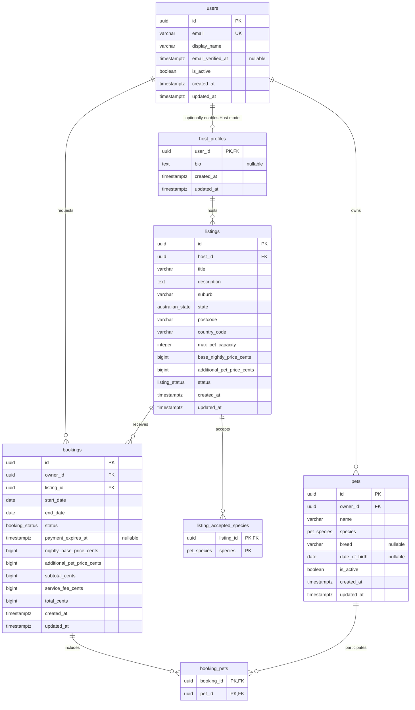

# Database: boarding MVP persistence

Milestone 2 implements persistence, not usable marketplace workflows. PostgreSQL 18
is the database; Python 3.14, typed SQLAlchemy 2 models and Alembic own the schema.
No authentication, booking, pricing or payment API exists. Every listing represents
boarding. Other service types are intentionally absent.

## Entity relationship diagram



The diagram shows physical cardinalities: a booking can physically have zero pets,
and a listing zero accepted species. Later services must require at least one at
request/publication time. Database nullability and Python types match. There are
seven domain tables, plus Alembic's version table.

## Account and profile decisions

User is the single account. HostProfile uses `user_id` as both its UUID primary key
and its foreign key to User. This enforces at most one host profile per account and
lets a listing reference an actual host, not just an arbitrary user. Absence of a
HostProfile means Host mode has not been enabled. Minimal bio data is optional.
There is no separate host login, role enum, password column or authentication code.

`email_verified_at` records successful verification, initially null. Challenge
tokens, expiry and resend handling belong to the authentication milestone.
A future email change must clear verification and require verification again; the
timestamp alone is not an authentication implementation. `is_active` supports
disabling an account without deleting historical references.
Display name is sufficient for now; legal names, telephone and other speculative
personal data are not collected.

### Email normalisation and uniqueness

SQLAlchemy's email assignment validator strips surrounding whitespace and lowercases
the address. PostgreSQL additionally requires `email = lower(btrim(email))` and a
nonempty, whitespace-free value, and enforces a unique constraint on that canonical stored value.
Thus direct SQL cannot insert mixed-case/space-padded alternatives to evade
uniqueness: it must first normalise or be rejected. The unique constraint is the
concurrency-safe authority, not a pre-insert Python lookup.

This deliberately treats the whole address case-insensitively for PAWTEL accounts.
It is not complete email syntax/deliverability validation. Internationalised email
and IDNA policy, including differences between Python and database Unicode casing,
must be settled before authentication; PostgreSQL's check will reject an ORM result
that is not canonical under its own lowercase rules. Email verification is not
implemented. CITEXT and a functional unique index were considered; a canonical
stored value plus ordinary uniqueness keeps the current design explicit and avoids
an extension dependency.

## Pets, locations and associations

A Pet belongs to exactly one User. DOG and CAT are the only species. Breed and date
of birth are optional; a date does not drift like a stored age. Size, weight, medical
information and images are deferred. `is_active` allows archiving without deleting
booked pets. Future validation must reject impossible dates of birth.

Listing holds suburb, Australian state/territory, a four-character numeric postcode
and country code AU. Postcodes are text to preserve leading zeroes. These fields
support later geocoding/search design, but no address verification, postcode/suburb
cross-validation, coordinates, private street address or map integration exists.
Listing status is DRAFT, PUBLISHED or ARCHIVED; it defaults to DRAFT. Publication
validation and listing lifecycle transitions remain future service responsibilities.

ListingAcceptedSpecies is a small relation keyed by `(listing_id, species)`. It
avoids one Boolean column per species and prevents duplicate acceptance rows. It
still permits only DOG/CAT today. BookingPet is keyed by `(booking_id, pet_id)`:
several pets can join one booking and one pet can join different bookings over time.
The composite keys identify these associations without redundant surrogate UUIDs.
Their UUID foreign keys still identify the actual entities. Neither association
needs independent lifecycle timestamps in this version.

**Important limitation:** the two BookingPet foreign keys only prove that the
booking and pet exist. They do not prove that the pet's owner is the booking owner.
The future booking service must load and validate every pet inside its transaction.
An integration test records this deliberate limitation. Redundant owner columns,
composite ownership foreign keys and triggers were not added just to enforce it.

## Money, dates and snapshots

All money is AUD integer cents stored as PostgreSQL BIGINT, never floating point.
The additional-pet price is intended as a nightly charge for each pet beyond the
first. The later pricing service must define rounding and calculate the agreed 10%
PAWTEL service fee. No pricing calculation is implemented in this milestone.

Booking requires snapshots of nightly base price, additional-pet rate, subtotal,
service fee and total. Future request creation should persist a server-generated
quote; acceptance should not silently replace it with a host's changed listing
prices. Historical bookings can therefore retain their agreed amounts. Listing
price edits do not alter those snapshots. Snapshot immutability, correct night/pet
counts, fee calculation and quote-consent rules are service responsibilities; a
foreign key to current listing prices would not preserve history.

Stay dates are DATE values representing listing-local calendar dates. Intervals are
half-open `[start_date, end_date)`; checkout does not consume the following night.
Capacity checks must operate per night, not simply count all overlapping requests.
All lifecycle timestamps are TIMESTAMPTZ. UUIDs have both ORM uuid4 defaults and
PostgreSQL `gen_random_uuid()` defaults for direct SQL. No UUID extension is needed.
`created_at` and `updated_at` default to database now(); ORM updates set updated_at.
Raw SQL writers must set updated_at themselves. There are no update triggers, event
history tables or claims of a complete audit trail.

## What PostgreSQL enforces

- Required values, UUID primary keys and valid native enum values.
- Unique canonical user email and nonblank email/display name/pet name/title/suburb.
- HostProfile's shared primary key: one profile per existing User.
- Required owners/hosts/listings/pets through foreign keys.
- Positive listing capacity; nonnegative listing prices and all booking snapshots.
- Four numeric postcode characters, AU country code and valid Australian states.
- End date strictly after start date.
- Total equals subtotal plus service fee (not the fee formula itself).
- AWAITING_PAYMENT has a non-null payment deadline.
- Unique listing/species and booking/pet pairs via composite primary keys.

PostgreSQL does **not** yet enforce legal booking transitions, eligibility/permissions,
pet ownership matching a booking, species compatibility, at least one booking pet,
capacity/overlap correctness, active/published status, self-booking restrictions,
price formulas or payment authenticity. These require transactional services and
future integration tests. No workflow should be inferred from inserting rows.

## Foreign key deletion policy

All parent references use RESTRICT, except child associations:

| Reference | On delete | Reason |
|---|---|---|
| HostProfile to User | RESTRICT | Do not silently remove a host identity. |
| Pet to User | RESTRICT | Preserve owned profile references. |
| Listing to HostProfile | RESTRICT | Preserve host/listing ownership. |
| Booking to User / Listing | RESTRICT | Preserve stay history. |
| BookingPet to Pet | RESTRICT | A booked pet must not disappear. |
| BookingPet to Booking | CASCADE | Association has no meaning without its booking. |
| ListingAcceptedSpecies to Listing | CASCADE | Association belongs to its listing. |

Archiving/deactivation is preferred for referenced parent records. Database-level
RESTRICT also protects direct SQL. ORM relationships are configured to leave those
restrictions to PostgreSQL, rather than nulling required foreign keys. Hard deletion
of an entire booking is still technically possible at this layer; future API
permissions/retention rules must forbid inappropriate deletion of historical stays.

## Index rationale

Primary keys and unique email automatically supply unique indexes. Additional
indexes are intentionally limited to these anticipated access paths:

| Index | Intended query/use |
|---|---|
| `ix_pets_owner_id` | Owner's pets and owner FK lookups. |
| `ix_listings_host_id` | Host's listings and host FK lookups. |
| `ix_bookings_owner_id` | Owner's booking history. |
| `ix_bookings_listing_status_dates` | Listing + reservation statuses + overlapping dates; leading listing_id also supports listing-only/FK lookups. |
| `ix_booking_pets_pet_id` | Reverse lookup of a pet's stays and pet FK deletion checks. |

The composite association primary keys already cover listing-to-species and
booking-to-pets. No redundant listing-only booking index, low-cardinality standalone
status index or speculative search/geospatial index is added. A B-tree with two
range date columns is not a proof of optimal overlap-query performance. These are
starting query-driven choices; measure EXPLAIN ANALYZE against realistic synthetic
data before claiming or tuning performance.

## Enums and migrations

Native PostgreSQL enums are `pet_species`, `australian_state`, `listing_status` and
`booking_status`. Python StrEnum names and values deliberately match their uppercase
stored values. Models share one metadata-bound species type across both tables.
Native types reject unknown values from every writer but require explicit migrations
for changes; removing/reordering values can require type replacement.

Revision `6667e668c806` was autogenerated then inspected/edited. It explicitly creates
each enum once, disables implicit per-table type creation and drops the types after
tables on downgrade. It does not import current model definitions. It creates seven
domain tables and their named constraints/indexes, without seed data or extensions.
Alembic imports the explicit model registry to discover metadata. `alembic check`
compares deployed schema with that metadata. Migrations, never startup create_all,
create the application schema.

## Local PostgreSQL 18 on this Mac

An existing non-Homebrew PostgreSQL **18.4** server was discovered at
`/Library/PostgreSQL/18`, using port 5432. It was left untouched. Homebrew now provides
PostgreSQL **18.6** (`postgresql@18`, bottle revision 1). Its dedicated cluster is at
`/opt/homebrew/var/postgresql@18`, listens only on 127.0.0.1:5433, and puts its Unix
socket in that data directory to avoid the other cluster's /tmp socket.

Homebrew installed ca-certificates, openssl@4, krb5 and readline as dependencies and
updated the shared xz formula from 5.8.3 to 5.8.4. No system PostgreSQL was replaced.
This is a local development setup, not production infrastructure or deployment.

### Reproduce the isolated setup on macOS

Inspect first; do not overwrite an existing cluster or blindly append conflicting
settings. These creation commands are for a **new** PAWTEL cluster and run once.
There is no Docker dependency.

```zsh
brew list --versions postgresql@18
ps -axo pid,command | rg '[p]ostgres'
brew install postgresql@18
pawtel_pg_bin="$(brew --prefix postgresql@18)/bin"
pawtel_pg_data="$(brew --prefix)/var/postgresql@18"
```

For a new cluster, set these values in its postgresql.conf before starting (5433
must be free):

```text
port = 5433
listen_addresses = '127.0.0.1'
unix_socket_directories = '/opt/homebrew/var/postgresql@18'
```

Use your actual `pawtel_pg_data` path for unix_socket_directories on Intel Macs.
In that cluster's pg_hba.conf, configure local socket authentication as `peer` and
IPv4/IPv6 loopback TCP authentication as `scram-sha-256`, including replication
rules. Do not leave Homebrew's initial trust defaults enabled. Existing PAWTEL
role-specific TCP rules also require SCRAM. The OS account owning the new Homebrew
cluster can administer it through its dedicated socket without a stored admin
password. No system-cluster authentication is changed.

```zsh
brew services start postgresql@18
"$pawtel_pg_bin/pg_isready" -h 127.0.0.1 -p 5433
"$pawtel_pg_bin/createuser" -h "$pawtel_pg_data" -p 5433 --pwprompt --no-superuser --no-createdb --no-createrole pawtel_dev
"$pawtel_pg_bin/createuser" -h "$pawtel_pg_data" -p 5433 --pwprompt --no-superuser --no-createdb --no-createrole pawtel_test
"$pawtel_pg_bin/createdb" -h "$pawtel_pg_data" -p 5433 --owner=pawtel_dev pawtel_dev
"$pawtel_pg_bin/createdb" -h "$pawtel_pg_data" -p 5433 --owner=pawtel_test pawtel_test
"$pawtel_pg_bin/psql" -h "$pawtel_pg_data" -p 5433 -d postgres <<'SQL'
REVOKE ALL ON DATABASE pawtel_dev FROM PUBLIC;
REVOKE ALL ON DATABASE pawtel_test FROM PUBLIC;
ALTER ROLE pawtel_dev SET timezone = 'UTC';
ALTER ROLE pawtel_test SET timezone = 'UTC';
SQL
```

Choose different local passwords when prompted. In the installed workspace,
cryptographically random passwords were generated and saved only to root `.env`
(mode 0600). The application roles are neither superusers nor database/role creators.
Each owns only its namesake database. Revoking PUBLIC database privileges prevents
one application role connecting to the other's database. They are migration-capable
local owners, not the restricted runtime/migrator split needed for deployment.

Copy `.env.example` to `.env` only on a fresh checkout; **do not overwrite an existing
local .env**. Fill in each role's password and URI-encode special characters. Keep
both URLs server-side; never place them in VITE_ variables. Root .env is ignored.

### Start, stop and inspect

```zsh
brew services start postgresql@18
brew services stop postgresql@18
brew services restart postgresql@18
brew services list
"$(brew --prefix postgresql@18)/bin/pg_isready" -h 127.0.0.1 -p 5433
"$(brew --prefix postgresql@18)/bin/psql" -h 127.0.0.1 -p 5433 -U pawtel_dev -d pawtel_dev -W
```

`brew services start` also enables launch at login. Only these commands manage the
Homebrew cluster; do not stop or reconfigure the separate /Library installation.
After pg_hba changes use `pg_ctl -D "$pawtel_pg_data" reload`. Readiness only proves
a server answers; the psql login verifies credentials and target database.

## Integration testing and safety

From backend with Python 3.14 .venv active:

```zsh
python -m alembic upgrade head
python -m alembic current
python -m alembic history
python -m alembic check
python -m pytest
python -m pytest -m integration
python -m pytest -m 'not integration'
```

Default pytest includes real PostgreSQL integration tests. Missing/unsafe
TEST_DATABASE_URL fails clearly, rather than silently skipping database coverage.
The last command runs database-independent health/safety tests when PostgreSQL is
unavailable. Health remains database-independent even with configured URLs.

Before connecting/migrating, the test guard requires driver postgresql+psycopg,
local host, database exactly pawtel_test, role exactly pawtel_test, no URL query
options and a different development database name. It checks server identity,
non-superuser role and PostgreSQL 18 before applying migrations. Safety checks have
unit tests. Do not point this suite at any database containing valuable data.

Tests migrate the dedicated test database using real Alembic DDL, never create_all.
Each model test binds a Session to an outer transaction and uses savepoints so
session.commit() cannot escape the test rollback. Failed constraint statements use
nested savepoints. Test data is synthetic and is rolled back after every test.
The migration round-trip test additionally requires the exact expected table set
and **no domain rows**, refuses a populated database, downgrades only pawtel_test to
base, checks enum cleanup, and upgrades it again in a finally block. It never
downgrades pawtel_dev. Do not run parallel pytest workers against the same database;
this milestone intentionally uses one local test process.
