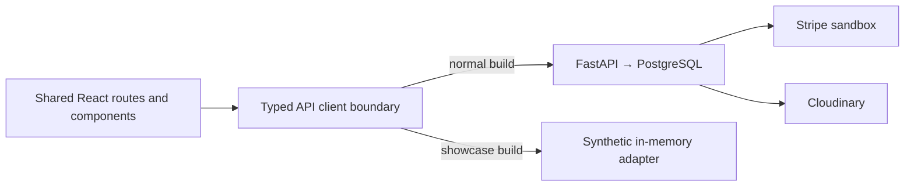

# PAWTEL frontend showcase

A recruiter can explore the existing PAWTEL interface without installing a backend,
creating an account or supplying credentials. **Frontend Showcase — synthetic data**
is a separate static build. It is not the hosted full-stack marketplace and does
not demonstrate real authorization, concurrency, provider reliability or payments.

## One UI, two data sources



Normal `npm run dev` / `npm run build` retain real API calls, cookie authentication,
CSRF and backend-owned prices/state. No FastAPI changes or authentication bypass
were added. `npm run build:showcase` selects Vite mode `showcase`, reading only the
committed public `frontend/.env.showcase` flag. Both mode and flag are required.
The adapter implements the frontend-facing response shapes and fails unsupported
operations locally. It never falls back to fetch. No MSW/internal API interception
is needed to run the showcase.

Twelve fictional stays cover Adelaide suburbs and a few other Australian cities.
DOG/CAT combinations, capacities, prices, local bundled SVG illustrations, Milo and
Luna, several fictional Hosts and sample Booking states provide useful starting
content. Date examples are anchored relative to initialization so they remain
future-facing; availability is deterministic capacity-only simulation, not a real
reservation calendar. Search filters, pagination and Listing galleries use the
same components as the real application.

## Explore in seconds

1. Browse the homepage/search and open a fictional stay.
2. Choose **Explore as Owner** in the persistent showcase bar; inspect My Pets.
3. Return to a stay, choose future dates and Milo/Luna, and request a simulated stay.
4. Switch to **Explore as Host**, open the inbox and accept that request.
5. Switch back to Owner, open My Bookings and observe **Payment required**.
6. Open Pay securely to view the shared summary and explicit disabled-checkout
   explanation. A separate confirmed example previews the successful UI.

Persona switching is local UI state, not login/security proof. Pet forms, cancellation,
Host accept/decline, Listing draft/edit/publish/archive and image ordering/removal
operate on memory only. Uploaded-file persistence is disabled: Cloudinary remains
a full-stack feature. No Stripe.js, Elements iframe, card input, payment credentials
or real Checkout Session is used. Simulated prices are illustrative, not the real
server pricing authority.

No localStorage, sessionStorage, cookies, tokens or passwords are created. Switching
persona clears private Query state while preserving shared synthetic journey data.
A page reload/new tab resets to the starting fixtures and anonymous browsing; use
client-side links to keep a journey. Reset showcase restores fixtures immediately.
The banner labels every route and simulated action context; use synthetic inputs.

## Run and verify locally

Only Node24 and frontend dependencies are required:

```sh
cd frontend
npm ci
npm run dev:showcase
# Or test the actual static build:
npm run build:showcase
npm run preview:showcase
```

Open the URL yourself (`http://localhost:5173` for dev; `http://127.0.0.1:4177` for
preview). Preview applies the committed static security headers. Stop it before
running tests that use the same port.

```sh
npm test -- --run
PLAYWRIGHT_BROWSERS_PATH=../.cache/pw-browsers npm run e2e:install
npm run test:showcase
```

For a project-local browser installation use
`PLAYWRIGHT_BROWSERS_PATH=../.cache/pw-browsers npm run e2e:install`.
The showcase suite starts/builds its own static preview and uses only bundled
headless Chromium, no screenshots/video/traces. It asserts static same-origin GETs
only, forbids fetch/XHR attempts, checks no storage/cookies, covers the persona
journey, deep links/reload and mobile overflow. No FastAPI/PostgreSQL/provider is
needed. The existing `npm run test:e2e` remains a DIFFERENT real
React → FastAPI → isolated PostgreSQL suite with its dedicated database prerequisite.

## Deploy manually on Vercel

No deployment or account setup has been performed. Review/commit/push the approved
changes yourself first and verify their CI result.

1. Sign into Vercel yourself. Use **Add New… → Project** (or the current import-project
   entry), then import your PAWTEL Git repository. Grant only permissions you accept.
2. Set project **Root Directory** to **frontend**. Outside-root source files are
   unnecessary for this build; no backend service or Vercel Function is deployed.
3. Confirm Framework Preset **Vite**, Node **24.x**, Install Command
   **npm ci --include=dev**, Build Command **npm run build:showcase**, Output Directory
   **dist**. `frontend/vercel.json` commits these commands/output/framework.
4. Add **no private environment variables**. Do not import root `.env`, Stripe,
   Cloudinary, database or demo-password values. The committed public mode file
   enables the build; do not override it with conflicting dashboard values.
5. Review Hobby/personal/non-commercial constraints and current quotas before
   confirming. This is a personal portfolio demonstration, not a commercial
   marketplace offer; reassess the plan before changing that purpose.
6. Click **Deploy** yourself. Initial import creates the first production deployment.
   Inspect its build result and open the generated `*.vercel.app` production URL.
7. Test root and direct refresh of `/stays`, `/stays/showcase-stay-1`, `/account/pets`,
   `/account/bookings`, `/host` and `/host/listings`. Anonymous private routes show
   the persona-access screen; they do not require passwords/backend availability.
8. Complete the journey above, reset, test mobile/keyboard and confirm the banner,
   no card fields and no network API/provider requests. Check local illustrations.
9. Confirm the production URL is publicly accessible without Vercel authentication.
   Preview deployments may be protected by Vercel Authentication; do not give a
   recruiter an inaccessible preview link or weaken unrelated account security.
10. Send the verified public URL back before updating the README showcase placeholder
    and GitHub website field. No URL is fabricated in source.

Git integration normally creates previews for non-production branches/PRs and
production releases for the selected production branch. Review that behavior in
Project Settings: Vercel's production/preview labels describe deployment channels,
not whether PAWTEL uses real data. Both use this synthetic showcase build.
No GitHub deployment secret is required by ordinary PR CI.

## Static routing and headers

`frontend/vercel.json` uses Vercel's documented Vite SPA rewrite to `/index.html`.
Actual bundled assets are served statically; client routes resolve through React.
There is deliberately no API server here. CSP blocks network connections/frames,
permits only local scripts/fonts/images (plus data/blob images), and disables
native form submissions; React handles forms locally. Other headers prevent MIME
sniffing/framing and disable camera/microphone/geolocation/payment permissions.
These showcase-only headers must NOT be copied to the full-stack Stripe app.
Local preview models headers/fallback, not the Vercel edge itself. Verify actual
headers/deep links after manual deployment. Do not enable third-party analytics,
Toolbar injection or provider widgets without reviewing the no-network contract/CSP.

## Boundaries and evidence

The showcase proves interface exploration, responsive structure, local adapter
contracts and simulated state transitions. It does not prove secure sessions,
transaction locks, webhook processing, durable media or managed deployment. Those
remain implemented/tested in the full-stack repository and real E2E suite.
Render full-stack deployment remains separate in [deployment.md](deployment.md).
Public showcase URL: **not deployed; awaiting manual deployment and verification**.

Current official references reviewed for this milestone:
[project import](https://vercel.com/docs/projects/managing-projects),
[Vite SPA](https://vercel.com/docs/frameworks/frontend/vite),
[build/root-directory settings](https://vercel.com/docs/builds/configure-a-build),
[Node24 build support](https://vercel.com/changelog/node-js-24-lts-is-now-generally-available-for-builds-and-functions),
[configuration schema](https://openapi.vercel.sh/vercel.json),
[environments and preview protection](https://vercel.com/docs/deployments/environments),
[Hobby](https://vercel.com/docs/plans/hobby),
[fair use](https://vercel.com/docs/limits/fair-use-guidelines).
